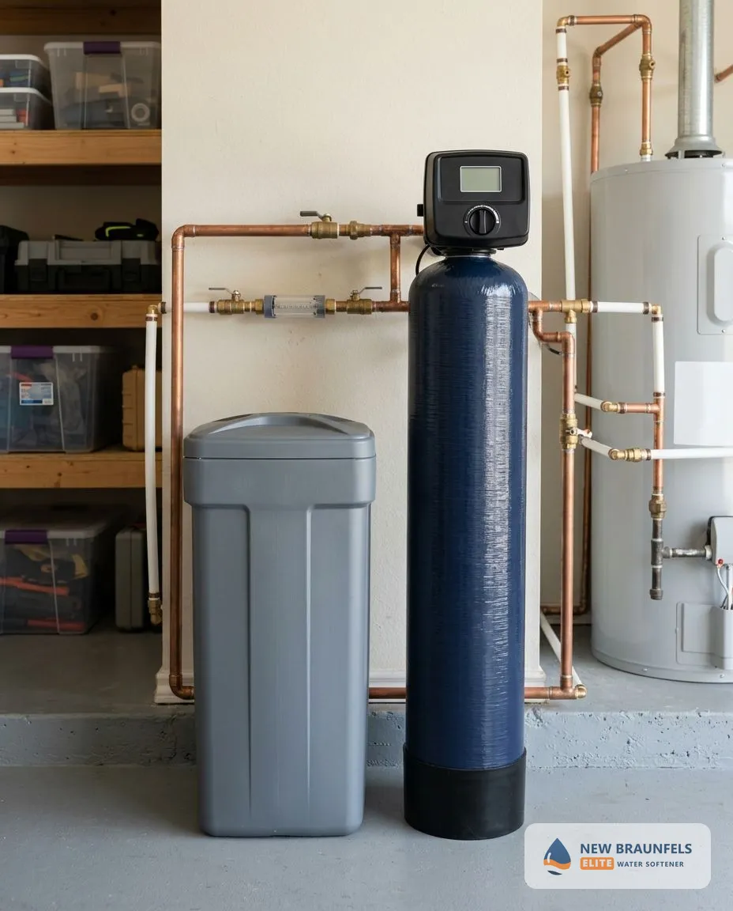
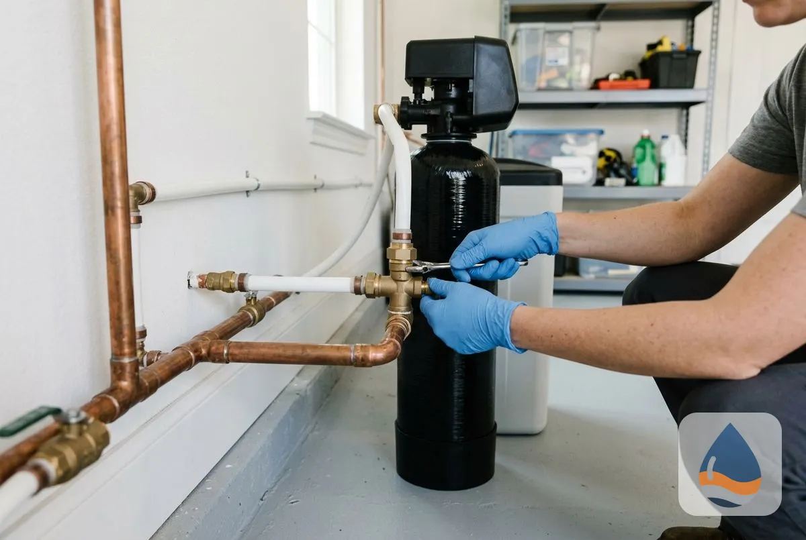
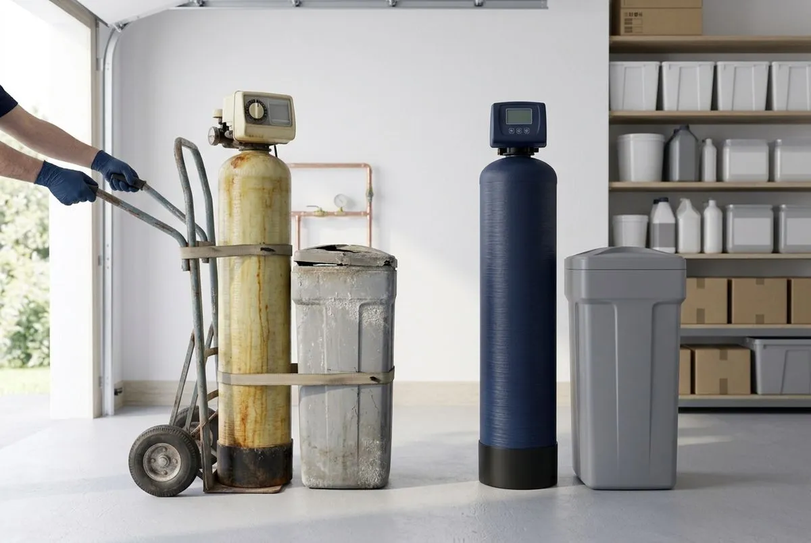
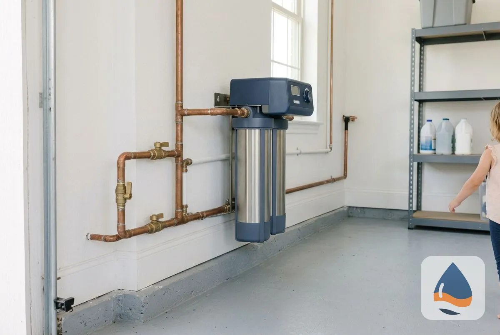
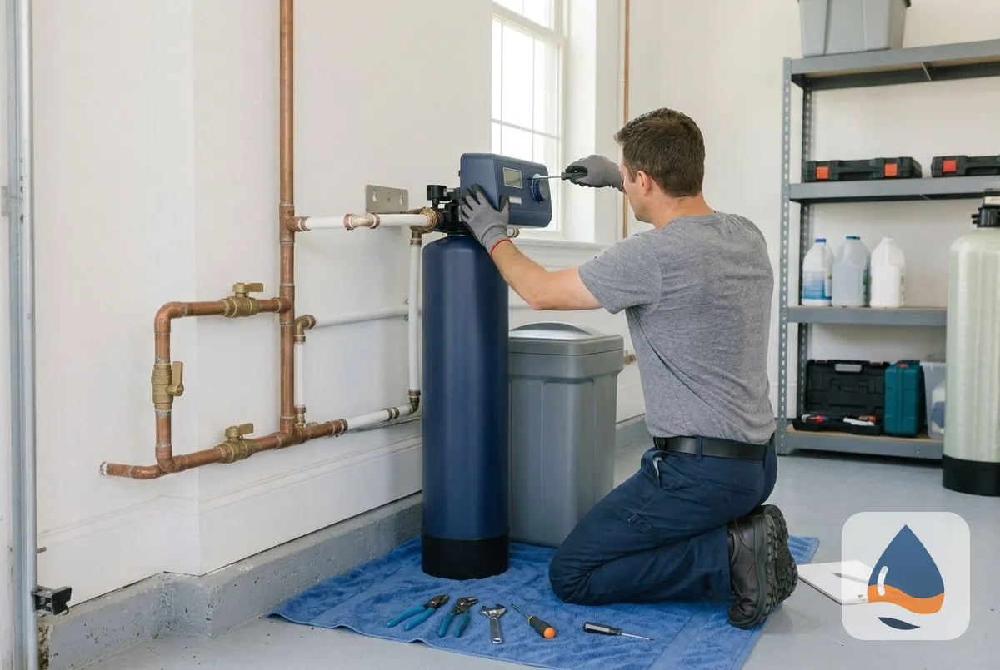
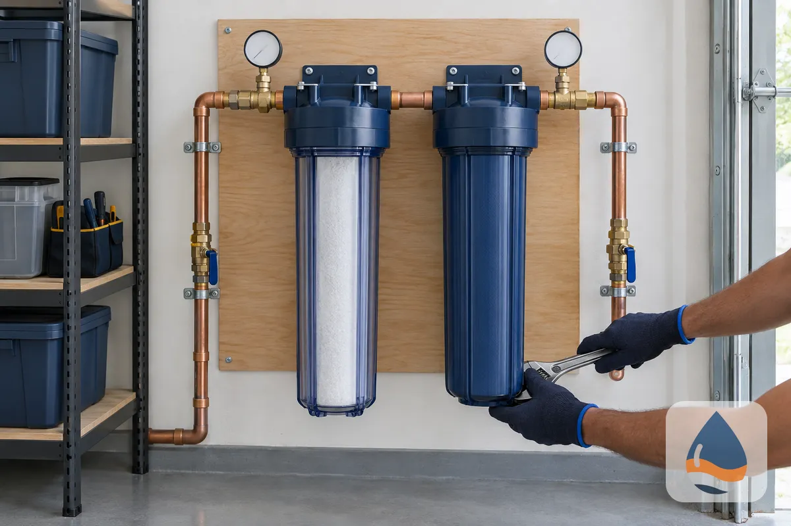
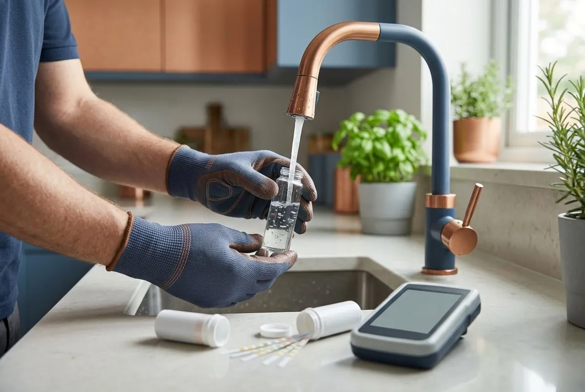
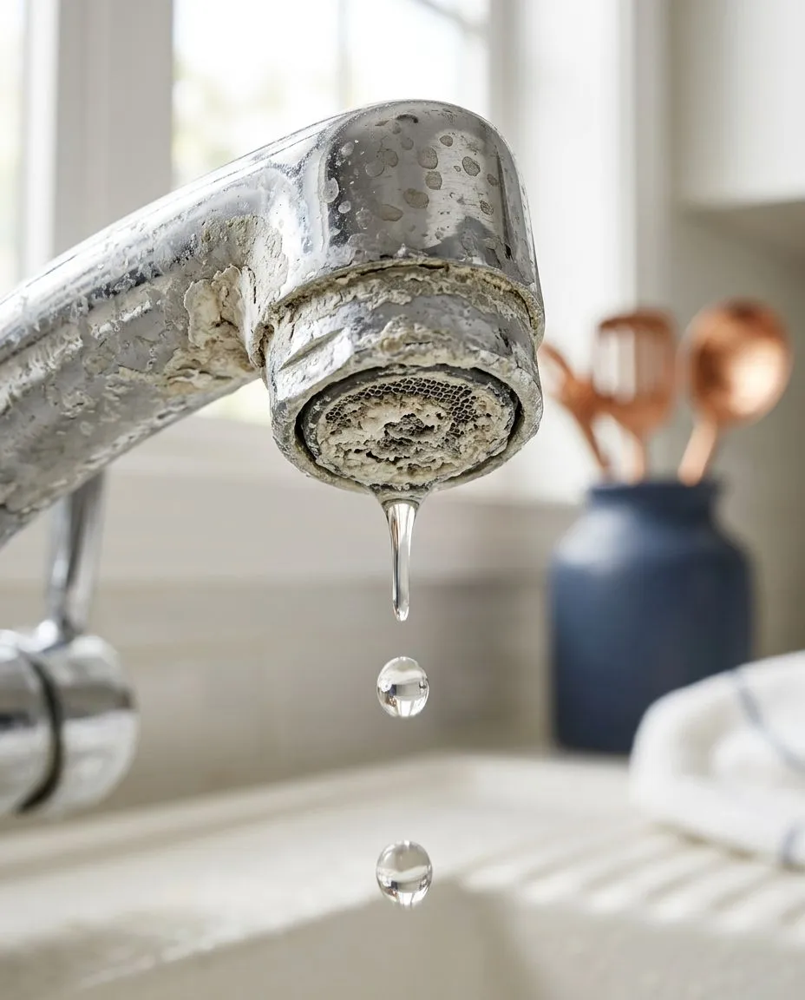
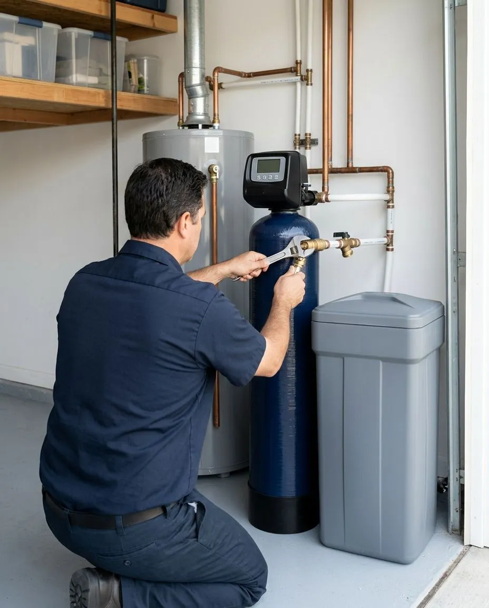

## Why Are We the Best Water Softener Installation Company in New Braunfels, TX?

Homeowners choose a water softener company on five things: who does the work, how the system is backed, how fast help arrives, whether the installer knows local water, and what the estimate includes. Use these six checks with any company, this one included.

- **Licence:** In Texas, anyone who installs a water softener under contract must hold a TCEQ Water Treatment Specialist licence or be licensed by the Texas State Board of Plumbing Examiners. Ask for the licence number and proof of insurance before work starts.
- **Warranty:** The estimate states the warranty on the equipment and on the labor. Read it before you approve the work.
- **Sizing by test:** A correct system size comes from a hardness test and your household's daily water use, not from a standard package.
- **Local water knowledge:** New Braunfels Utilities (NBU) blends Guadalupe River surface water with Edwards Aquifer and Trinity Aquifer groundwater, so hardness differs from a city that pumps one aquifer.
- **Scheduling:** Ask how quickly the installer can fit your job in. Same-day service depends on technician availability.
- **Itemized estimate:** The estimate lists the unit, the plumbing work and the labor, so you see what is included before work starts.

[Request Your Free Estimate](#estimate)

## What Water Softener Services Are Available in New Braunfels, TX?

New Braunfels Elite Water Softener covers six core services, from first installation to long-term maintenance, and adds specialty systems for larger homes, businesses and wells.

### Water Softener Installation

Installation connects a new softener to your home's main water line so every faucet, shower and appliance receives softened water. The unit is sized to your household and water use, fitted with a bypass valve, connected to a drain and brine line, programmed and tested at every tap before the technician leaves.

### Water Softener Replacement

Replacement removes an old or failing softener and installs a new, correctly sized unit on the existing plumbing. It covers full system replacement, resin bed replacement and upgrades for systems that no longer soften, leak, or cost more to repair than they are worth.

### Salt-Free Water Softener Systems

A salt-free system conditions hard water so scale no longer clings to pipes and fixtures. It does not remove calcium and magnesium, needs no salt and no drain line, and fits homeowners who want lower maintenance over full softening.

### Water Softener Repair & Service

Repair and service restores softeners that stop regenerating, leave hard water, run out of salt too fast or leak at the control head. Routine service includes resin and brine tank checks, cleaning, salt refills and valve testing.

### Whole House Water Filtration

Whole house filtration treats water where it enters the home, reducing chlorine taste and sediment before it reaches every tap. It pairs with a softener because filtration and softening solve different problems.

### Water Quality Testing

A water quality test measures hardness, iron, pH, total dissolved solids and other values that decide which system fits. It is the first step of every recommendation.

Dual tank and commercial water softeners, water conditioners, reverse osmosis and UV purification, drinking water systems, well water treatment and contaminant removal filters are also available.

## Why Is New Braunfels Water So Hard?

New Braunfels water is hard because of where it comes from.

### Where Does New Braunfels Water Come From?

According to New Braunfels Utilities' 2025 water quality report, NBU has 54,575 acre-feet of water available, and the majority is treated at the Gruene Road Surface Water Treatment Plant from the Guadalupe River. NBU also uses groundwater from the Edwards Aquifer and the Trinity Aquifer, and has agreements to buy water from Green Valley Special Utility District and the Guadalupe-Blanco River Authority as needed.

### Why Does Limestone Make Water Hard?

Groundwater that has moved through limestone picks up dissolved calcium and magnesium, and those two minerals define hardness.

### How Is Water Hardness Measured?

Hardness is measured in milligrams per liter (mg/L) or grains per gallon (gpg), where 1 gpg equals about 17.1 mg/L. The U.S. Geological Survey rates water under 60 mg/L as soft, 61 to 120 mg/L as moderately hard, 121 to 180 mg/L as hard and anything over 180 mg/L as very hard, and the Water Quality Association calls anything over 10.5 gpg very hard.

### How Hard Is New Braunfels Water?

NBU's 2018 water quality report put average hardness at 15.1 grains per gallon, about 258 mg/L, with a range of 8.1 to 19.5 grains per gallon, which places the average in the very hard range. A 2023 peer-reviewed study in the journal Groundwater (Simbo) reports calcium and magnesium for ten samples of NBU system water taken in 2020 and 2021, and those values calculate to 13.2 to 15.9 grains per gallon, which agrees with the 2018 figure. <mark class="data-gap">[VERIFY: NBU's current average hardness; its 2019 to 2025 reports do not list hardness]</mark>

### What Does NBU's Water Quality Report Show?

NBU reports a total chlorine residual that averaged 2.58 ppm in 2025, against a limit of 4 ppm, and rates its water Superior with the Texas Commission on Environmental Quality. NBU's 2025 report lists no violations, and hardness itself is a household problem: scale narrows pipes, coats heating elements and spots glass.

### How Do You Find Your Exact Hardness?

A free water test shows the exact reading at your tap, because the supply blend and home plumbing both move the number.

## How Does Water Softener Installation Work in New Braunfels, TX?

Every installation follows the same four steps, from the first call to the follow-up visit.

### Step 1: Free Estimate and Water Test

A technician tests your water for hardness and reviews your household size, your water use and the install location.

### Step 2: Custom System Recommendation

You receive a written recommendation with the system type, the grain capacity and an itemized price. At 15 gpg, a household of four using 320 gallons a day removes about 4,800 grains daily, so a 48,000-grain unit regenerates about every 10 days.

### Step 3: Professional Installation

A qualified technician installs the system, connects the drain and brine line, programs the control head and tests every tap. A standard install typically takes about 2 to 4 hours.

### Step 4: Ongoing Support and Maintenance

Salt refills, settings and a yearly inspection keep the system at capacity, and you can call with questions after the job is done.

## Frequently Asked Questions About Water Softeners in New Braunfels, TX

Most questions homeowners ask before buying fall into eight areas: water hardness, cost, system choice, timeline, water source, upkeep and where we work.

How hard is New Braunfels water?

New Braunfels water is hard. NBU's 2018 water quality report put average hardness at 15.1 grains per gallon, about 258 mg/L, classified as very hard by the Water Quality Association, with a range of 8.1 to 19.5 grains per gallon. Hardness differs by supply mix and over time, so a free test at your tap gives the number that matters for sizing.

How much does water softener installation cost in New Braunfels, TX?

Installed price depends on system capacity, system type, plumbing layout and whether a drain line already exists. The free estimate gives an itemized price for your home before any work begins.

What is the best water softener for New Braunfels water?

The best system matches your household size and your test results. A salt-based softener removes hardness minerals and suits readings above 10.5 gpg, and the technician sizes its capacity to your daily water use. Salt-free systems suit homeowners who prioritize low maintenance.

Salt vs. salt-free water softener: what is the difference?

A salt-based softener removes calcium and magnesium through ion exchange and needs salt refills and a drain. A salt-free system conditions the water so scale does not stick, adds no sodium, and leaves the minerals in the water. Salt-based units deliver true softening, while salt-free units reduce scale.

How long does water softener installation take?

Most installations finish in a single visit, typically in about 2 to 4 hours. The technician confirms the timeline at your estimate, based on plumbing access and system type.

Do I need a water softener with city water or well water in New Braunfels?

Both benefit. City water from NBU blends Guadalupe River surface water with Edwards Aquifer and Trinity Aquifer groundwater, and it still arrives hard. Private well water draws directly from an aquifer and can be harder and carry iron or other minerals. Nobody tests a private well for you, so a test shows whether a softener alone is enough.

How often does a water softener need maintenance?

Check the salt level monthly and refill when it drops below one-third full. Have a technician service the system once a year to inspect the resin bed, brine tank and valve.

What areas do you serve?

We serve New Braunfels, Canyon Lake, Seguin, San Marcos, Wimberley, Bulverde, Spring Branch, Gruene, Vintage Oaks, Veramendi, Creekside and River Chase.

## Where Do You Install Water Softeners Around New Braunfels, TX?

New Braunfels Elite Water Softener provides water softener installation, replacement, repair and water testing across New Braunfels and the Texas Hill Country, including Canyon Lake, Seguin, San Marcos, Wimberley, Bulverde, Spring Branch, Gruene, Vintage Oaks, Veramendi, Creekside and River Chase. Whether your home uses NBU city water or a private well, call or request a free estimate and we will confirm service to your address.
